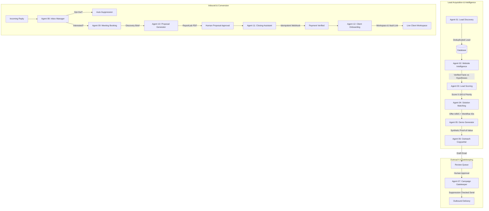

# BRIX SALES OS — Architecture & Engineering Specification

## 1. System Overview

Brix Sales OS is built on a modular, decoupled architecture consisting of:
1. **Inference Layer**: Local NVIDIA RTX 5060 GPU running Ollama with `qwen2.5-coder:7b` (zero API billing, 100% data privacy).
2. **Workflow Inventory**: 60 production n8n workflows audited and indexed in `workflow_registry.json`.
3. **Agent Pipeline Core**: 12 specialized Python agents extending `BaseAgent` with uniform error trapping, duration tracking, and audit logging into SQLite/PostgreSQL.
4. **API & Orchestration Layer**: Async FastAPI server handling CRUD, lead processing pipelines, campaign review queues, and idempotent webhooks.
5. **Command Center UI**: A dark-first, high-density dashboard built for executive visibility and human-in-the-loop approval.

---

## 2. Multi-Agent Data Flow

---

## 3. Open-Source Evaluation & Integration Matrix

As required by the Master Prompt, the following four open-source projects were evaluated:

| Project | License & Status | Evaluation Findings | Architectural Decision |
| :--- | :--- | :--- | :--- |
| **Kandid-ai/AgentSDR** | MIT &bull; Active | Comprehensive full-stack AI SDR (Next.js + PostgreSQL 18 + Prisma). Seeded with 4 n8n outreach campaigns. | **Integrated Locally** on `http://localhost:3000` via Docker Compose; serves as an external outbound sequencing engine. |
| **eracle/OpenOutreach** | Open Source | Python CLI for cold outreach scraping and email verification. | **Adapted logic** for domain deduplication and verified observations into Agent 01 and Agent 02. |
| **xyluxx/openoutbound** | Open Source | Cold email delivery engine focusing on inbox rotation and warm-up. | **Reference architecture** for suppression lists, bounce backoff, and daily send caps in Agent 07. |
| **twentyhq/twenty** | AGPL-3.0 &bull; Highly Active | Full enterprise CRM (NestJS, React, GraphQL). High resource overhead (Postgres, Redis, worker containers). | **Connector pattern implemented** in `database/models.py`; data models mirror Twenty CRM entities for direct API sync without forcing local container bloat alongside Ollama. |

---

## 4. Database Entity Relationships

The schema is implemented via SQLAlchemy with SQLite (default) and PostgreSQL compatibility:
- **`organizations`**: Master business identity, normalized domain, industry, and country.
- **`contacts`**: Decision-maker information, verified email, consent status (`LEGITIMATE_INTEREST_B2B`).
- **`research_reports`**: Output of Agent 02 storing `verified_observations` and `hypotheses` separately.
- **`lead_scores`**: Breakdown of the 6 scoring criteria (industry 25, evidence 25, size 15, buying signal 15, contact 10, geo 10).
- **`workflow_registry`**: 60 entries mapping n8n JSON filenames to operational readiness, nodes, and pricing.
- **`solution_matches`**: Matched Offer (A, B, or C) and specific workflow IDs.
- **`demos`**: Cached proof-of-concept HTML and synthetic payloads.
- **`campaigns` & `outreach_messages`**: Human approval queue and delivery audit log.
- **`suppression_entries`**: Strict opt-out email and domain suppression registry.
- **`conversations`**: Reply history and AI intent classification (`INTERESTED`, `PRICING`, `UNSUBSCRIBE`, etc.).
- **`meetings`**: Scheduled discovery calls, timezones, and pre-call discovery questions.
- **`deals` & `proposals`**: Kanban stages, proposal terms, and generated PDF file paths.
- **`invoices` & `payments`**: Idempotent payment processing records (`idempotency_key` unique constraint).
- **`projects`**: Post-payment onboarding checklists and provisioned workspace paths.
- **`agent_runs` & `audit_logs`**: System execution metrics, duration in ms, and error tracking.

---

## 5. Operating Modes

1. **`SIMULATION`**:
   - Uses synthetic prospect data and deterministic mock LLM outputs.
   - External network calls and payment webhooks are simulated.
   - Ideal for CI/CD pipelines and automated integration testing.
2. **`ASSISTED_PRODUCTION` (Default)**:
   - Researches real public websites using permitted methods.
   - AI generates real scores, solution matches, and personalized outreach drafts.
   - **All external messages and proposals require human approval** before dispatch.
3. **`CONTROLLED_AUTOMATION`**:
   - Allows unattended execution for low-risk actions (lead enrichment, internal scoring, draft generation, CRM synchronization).
   - High-risk actions (outbound email sending, contract commitments) remain behind human approval.
   - Global Emergency Stop halts all processing immediately when triggered.
